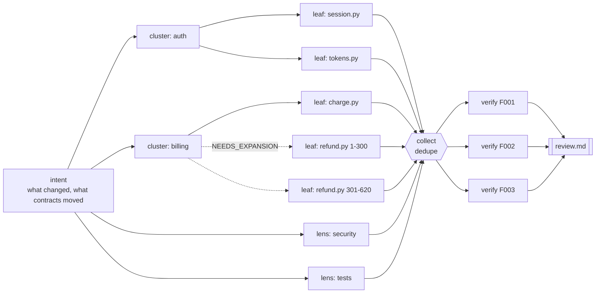

# claude-skills

Agent skills I use and maintain, packaged as a [Claude Code plugin marketplace](https://code.claude.com/docs/en/plugin-marketplaces).
Every skill is a plain `SKILL.md` folder, so it also works in any agent that supports the skills format.

| Plugin | What it does |
|---|---|
| [`dag-pr-review`](plugins/dag-pr-review/skills/dag-pr-review/SKILL.md) | Multi-agent pull request review. It plans a dependency graph of review tasks, runs ready tasks as parallel subagents in waves, splits oversized tasks at runtime, and adversarially verifies every finding before reporting it. |

## Install

In Claude Code:

```text
/plugin marketplace add polar3197/claude-skills
/plugin install dag-pr-review@polar3197-skills
```

Or from a shell: `claude plugin marketplace add polar3197/claude-skills && claude plugin install dag-pr-review@polar3197-skills`.

**Without the plugin system:** copy `plugins/dag-pr-review/skills/dag-pr-review/` into `~/.claude/skills/` (or your
agent's skills directory). For claude.ai, zip that folder and upload it under Settings → Skills. Subagent parallelism
needs Claude Code, and elsewhere the skill runs its nodes one after another.

> Skills can run code. Read a skill's `SKILL.md` and `scripts/` before installing it. Everything here is readable
> Python using only the standard library, with no network calls.

---

## dag-pr-review

```text
/dag-pr-review:dag-pr-review 1234          # a PR number (uses gh)
/dag-pr-review:dag-pr-review               # current branch vs the default branch
> review this branch thoroughly            # or just ask; the skill triggers on its description
```

### How it works



1. **Tier.** `dagctl.py init` diffs the branch, tags files as sensitive, test, docs, generated or binary, and picks a
   risk tier: trivial, lite or full. The tier sets the graph shape and the caps. Any security-sensitive path forces
   the full tier.
2. **Plan.** `autoplan` writes a deterministic draft graph. For big PRs, the orchestrator regroups clusters by
   feature. `load` then rejects cycles, unknown files, anything over the node cap, and any changed file that no leaf
   owns.
3. **Execute in waves.** `next` returns every node whose dependencies are finished, up to the concurrency cap, with
   the critical path first. The orchestrator launches them all in one message, so they run in parallel. Each node
   passes a summary of at most 150 words, containing facts only, to its dependents. Edges mean *needs context
   from*.
4. **Expand as needed.** A leaf or cluster whose scope is too big returns `NEEDS_EXPANSION` with child scopes. The
   scheduler inserts the children and rewires dependents, within bounded depth and budget.
5. **Verify.** `collect` dedupes findings across nodes and gives each critical or major finding its own verifier,
   whose job is to try to refute it. Verifiers never see the PR description or the reviewer's confidence, and they
   run cheap checks (grep, a single test, a type check) when that settles the question.
6. **Report.** Only confirmed findings are listed as issues. Severe findings that couldn't be settled go under
   "needs a human look". Failed nodes, declined scopes and skipped files are listed under **coverage gaps**, so
   "no issues" never quietly means "not reviewed".

The orchestrating agent only ever sees short JSON status lines. The diff, prompts and results live in
`.dag-review/`, so it stays small and can resume after a crash or context compaction (`dagctl.py reclaim`).

### Where the ideas come from

The design borrows from these sources:
- Anthropic's `code-review` plugin: one validator per issue.
- Cloudflare's reviewer: risk tiers.
- Qodo PR-Agent: packing the diff to a budget.
- CodeRabbit and Bugbot: verification and corroboration.
- Research on confirmation bias: withholding the PR description from bug hunters.
- Refute-or-Promote: adversarial verification.
- LLMCompiler: DAG dispatch.
- ADaPT: decomposing as needed.

[design-notes.md](plugins/dag-pr-review/skills/dag-pr-review/references/design-notes.md) has the details, links and
roadmap.

### The scheduler on its own

`scripts/dagctl.py` is a standard-library CLI. You can drive it from any agent framework or CI job:

```bash
D=plugins/dag-pr-review/skills/dag-pr-review/scripts/dagctl.py
python3 $D init --base origin/main
python3 $D autoplan && python3 $D load
python3 $D next                # -> {"launch": [{"id", "prompt_file", "result_file"}, ...]}
python3 $D complete <id> ...   # validates each result file against the node contract
python3 $D collect             # -> verifier nodes; loop next/complete again
python3 $D report              # -> .dag-review/review.md + review.json
```

---

## Adding a skill

1. Create `plugins/<plugin>/.claude-plugin/plugin.json` and `plugins/<plugin>/skills/<skill>/SKILL.md`. The
   frontmatter needs a `name` that matches the folder, plus a `description` of at most 1024 characters that says
   what the skill does *and when to use it*.
2. Add the plugin to `.claude-plugin/marketplace.json`, using the same `name` as its `plugin.json`.
3. Run `python3 scripts/validate_skills.py` (and `claude plugin validate .` if you have Claude Code). CI runs the
   same checks.

## License

MIT
